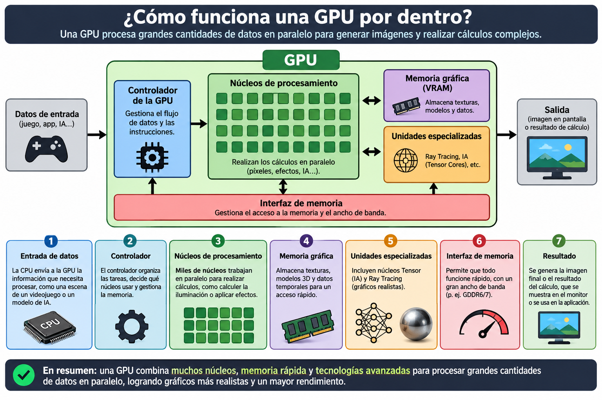
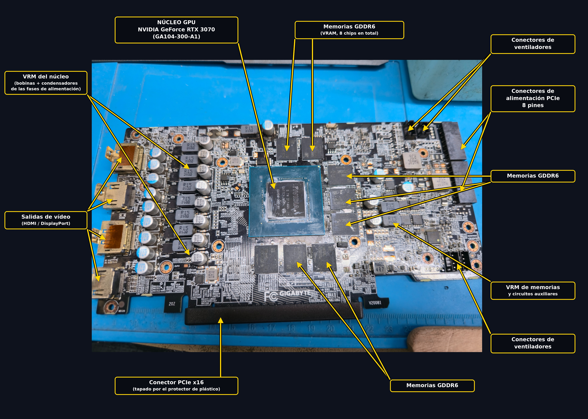
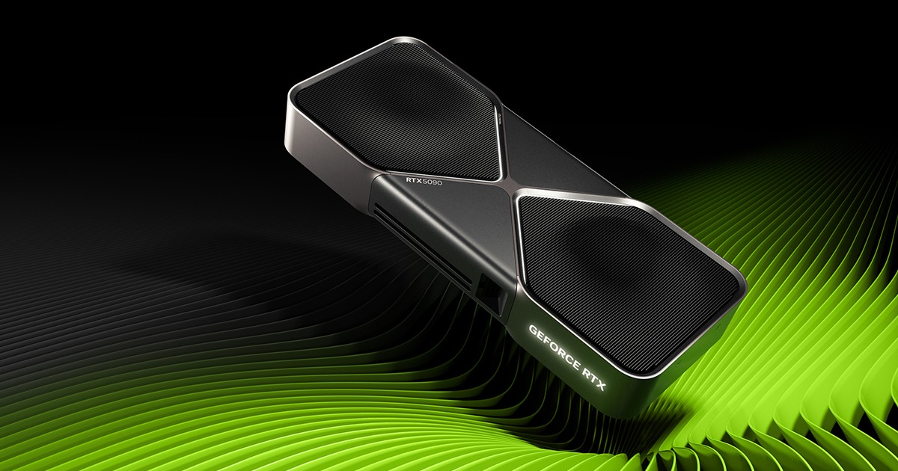

# Puzzle UT2 · Pieza 11: Unidad de Procesamiento Gráfico

**Grupo:** Pablo Quiros Dominguez|(@Ferro-cmd) · Esteban Amador Fernández (@esamdor23)

## 1. Qué es y qué función cumple en el sistema
Las siglas GPU, significan "Unidad de Procesamiento Gráfico", en español, y es un circuito electrónico, que sirve para acelerar el procesamiento informático de gráficos e imágenes.  Al principio fue concebido como un procesador especializado en gráficos 3D, comenzó siendo un hardware de función fija, destinada a acelerar operaciones en paralelo durante el renderizado 3D en tiempo real. Durante los años posteriores, adquirieron más capacidad de programación, y en 2003 algunas etapas de canalización gráfica llamada pipeline se volvieron totalmente programables, gracias a esto se permitía la ejecución de código personalizado en paralelo para cada componente de una escena 3d o imagen. 

Su función principal es generar las imágenes que vemos, recibe de la CPU las instrucciones programa, y calcula el color de cada píxel de la pantalla, decenas o cientos de veces por segundo, y luego envía la imagen al monitor por HDMI o DisplayPort.

Otra función es acelerar cálculo en paralelo, como sus núcleos sirven para cualquier operación matemática masiva, se usa también para entrenar modelos de IA, codificar y decodificar video y realizar simulaciones científicas, minería de datos etc.

## 2. Cómo funciona por dentro

Una GPU es un procesador pensado y especializado pensado para ejecutar la misma operación sobre muchísimos datos a la vez. La CPU envía trabajo como  geométrica, texturas, programas llamados shaders o kernels por el bus PCIe y lo reparte entre sus unidades de cálculo. Los núcleos de sombreado son las unidades que se ejecutan esos programas: los shaders son simplemente programas que corren en  estos núcleos. Cada fabricante nombra esas unidades de forma distinta, pero la estructura es parecida.

| Concepto | NVIDIA | AMD | Intel |
|---|---|---|---|
| Unidad básica de cálculo | SM (multiprocesador de streaming) | CU (Compute Unit), agrupadas en WGP en RDNA | Xe-core |
| Núcleos de cálculo | CUDA cores | Stream processors | Vector engines |
| Matrices / IA | Tensor cores | AI accelerators (desde RDNA 3) | Motores XMX |
| Trazado de rayos | RT cores | Ray accelerators | Unidades RT |
| Grupo de hilos | Warp (32 hilos) | Wavefront (32 o 64) | Subgrupo (8, 16 o 32) |
| Caché destacada | L2 grande | Infinity Cache (caché extra entre L2 y VRAM) | L2 grande |
| Escalado por IA | DLSS | FSR | XeSS |
| Programación general | CUDA | ROCm / HIP | oneAPI / SYCL |

## 3. Características, unidades y cómo se miden

| Característica | Unidad | Valores típicos hoy | Qué significa |
|---|---|---|---|
|Frecuencia de reloj|MHz o Ghz| entre 1,5 y 3 Ghz|Indica la cantidad de ciclos de reloj que realiza la GPU por segundo|
|Memoria Gráfica VRAM| GB|Entre 8 y 16 GB. Las de gama alta pueden ser de 32GB|Capacidad de almacenamiento de datos gráficos |
|Rendiento de cálculo|GFLops o TFLOPS|Aproximadamente 10-50 TFLOPS dependiendo de gama y arquitectura |Cantidad de operaciones de coma flotante que puede realizar por segundo|
|Ancho de banda GB/s|GB/s| Entre 300 y 800GB/s en muchas GPU actuales. Las de gama alta pueden superar los 1000GB/s| Cantidad de datos que se pueden transferir por segundo|
|Consumo eléctrico| W vatios| Entre 100 y 350 W en muchas tarjetas de cosnumo. Las de gama alta pueden superar los 500 W| Potencia electrica que consume la GPU|
|Temperatura| ºC grados celsius| Entre los 60-85ºC| Temperaturas que suelen alcanzar durante su funcionamiento|
|Rendimiento en videojuegos| Fps fotogramas por segundo|Entre 60 y 144 Fps como referencia, depende de juego resolución y calidad gráfica|Número de fotogramas que se generan o muestran por segundo|  
## 4. Tipos, evolución y estándares actuales
Tipos:

**1º Gráficas Integradas (iGPU):** Están incorporadas en el procesador o en el propio sistema. Utilizan normalmente la memoria RAM del ordenador. 
- Son economicas y consumen poca energia.
- Se utilizan para ofimática, navegación,videos y juegos poco exigentes.
- Ejemplo: Intel UHD Graphics y AMD Radeon 780M.

**2º Graficas dedicadas (dGPU):** Son tarjetas independientes que se conectan a la placa base y disponen de memoria gráfica propia(VRAM).
- Ofrecen mayor potencia de procesamiento.
- Se utilizan para videojuegos, edidición de vídeo,diseño 3D e inteligencia artificial.
- Ejemplo: Nvidia GeForce RTX 5090, AMD Radeon RX 9070XT.

**3º Graficas externas (eGPU):** Son tarjetas dedicadas instaladas en una carcasa externa que se conecta al ordenador mediante una interfaz de alta velocidad.
- Permite aumentar la potencia de trabajo en algunos portatiles.
- Se utiliza para videojuegos y trabajos gráficos exigentes.
- Suelen conectarse mediante Thunderbolt(conexión de alta velocidad desarrollada por Intel, desde la version 3 adelante usa USB Tipo-C) o USB4 compatible.

**4º Graficas Virtuales (vGPU):** Son una tecnología que permite compartir recursos de una tarjeta gráfica física entre varias maquinas virtuales o usuarios, proporcionando a cada uno acceso a una GPU virtual.
- Permiten utilizar los recursos graficos de una misma GPU física entre varios usuarios.
- Se utilizan en centros de datos, escritorios virutales, diseño 3D y aplicaciones profesionales.
- Ejemplo Nvidia vGPU.

**5º Gráficas profesionales:** Estan diseñadas para aplicaciones profesionales y estaciones de trabajo.
- Priorizan la estabilidad y la compatibilidad con programas profesionales.
- Se utilizan para arquitectura, ingeniería, CAD , simulaciones y renderizado.
- Ejemplos: NVIDIA RTX PRO Y AMD Radeon PRO.
## 5. Un modelo real: ficha técnica interpretada

**Modelo** Nvidia GeForce RTX 5090 (https://www.nvidia.com/es-es/geforce/graphics-cards/50-series/rtx-5090/)

| Dato de la ficha | Qué significa | ¿Es bueno? ¿Para qué uso? |
|---|---|---|
|Arquitectura Blackwell| Es la tecnologia y diseño interno sobre el que esta construida la GPU|La usamos para el rendimiento grafico la eficiencia y el procesamiento de ia|
|21760 nucleos CUDA|Son unidades de procesamiento que realizan calculos en paralelo| Se utilizan para el renderizado, videojuegos calculos cientificos e ia|
Frecuencia base 2,01GHZ| Velocidad de funcionamiento de los nucleos de la GPU| Es una frecuencia alta y sirve para procesar rapidamente|
|Frecuencia Boost 2,41GHZ|Velocidad que pueda alcanzar automaticamente la GPU cuando las condiciones la permiten| Aumenta mucho el rendimiento|
|32GB DDR7|Cantidad y tipo de memoria dedicada de la tarjeta grafica| Permite trabajar con texturas en alta resolucion, videojuegos eigentes, videos y modelos IA grandes|
|Interfaz de memoria 512 bits|Anchura del bus por el que se transfieren datos| Permite transferir grandes cantidades de informacion simultaneamente|
|Ancho de banda 1.792GB/s|Cantidad de datos que puede transferir por segundo| Facilita trabajar con grandes volumenes de datos y graficos de alta calidad|
|Nucleos Tensor de 5ªgeneración|Núcleos especializados en operaciones matematicas utilizadas por la IA| Se utilizan para el aprendizaje automatico y tecnologias como DLSS|
Nucleos Ray Tracing de 4ª generacion|Unidades especializadas en calcular iluminacion sombras y reflejos| Se utiliza para conseguir graficos mas realistas en videojuegos y aplicaciones 3D|
|3352 AI tops| Capacidad de procesamiento de operaciones de inteligencia artificial por segundo| Permite acelerar tareas de IA y generacion de imagenes|
|PCI express 5.0| Interfaz de conexion entre la placa base y la GPU| Ofrece un gran ancho de banda para la comunicacion con el resto del ordenador|
|Potencia Gráfica 575 W| Consumo electrico aproximado| Es una potencia alta, necesita una buena fuente de alimentacion y una refrigración acorde|
|Resolución máxima 8k|Resolucion de imagen que puede transmitir a una pantalla compatible| Permite trabajar y jugar a gran resolución|
|3 displayPort y 1 HDMI| Conexiones disponibles para monitores |Permite conectar hasta 4 pantallas|
|Direct x12 Ultimate| Conjunto de tecnologias y herramientas que permiten ejecutar graficos avanzados en videojuegos| Muy buenom permite aprovechar gráficos modernos|

## 6. Averías típicas y errores al elegirla o instalarla
**Artefactos visuales:** ( Líneas , puntos , cuadros o colores raros en pantalla). Entre sus causas habituales, pueden ser por sobrecalentamiento, problemas en la fuente de alimentación o fallos en los drivers (Software de la GPU), el overclock de la gráfica (técnica que consiste en forzar la GPU a una frecuencia de reloj mas alta). Indicio para detectar este fallo, si los artefactos aparecen en varias aplicaciones y tras actualizar/cambiar los drivers, continuan estos errores, es probable que sea culpa del hardware.

**Pantalla negra o sin imagen:** Puede deberse a un fallo real en la tarjeta, o simplemente a que el cable del monitor, o la entrada de este puede no estar bien conectado a la ranura PCIe. Además es tambien interesante comprobar los drivers para descartar un fallo real. Los drivers corruptos o desactualizados son algunas de las razones más comunes por las que una tarjeta en buen estado da la impresión de no funcionar.

**Sobrecalentamiento:** Una GPU cuando el calor es excesivo, lo primero que hace es reducir su rendimiento, llegando a provocar tirones, si la temperatura sigue subiendo, se apaga automaticamente para protegerse,por lo que no daría imagen, es decir pantalla negra. Hay programas con los que monitorizar las temperaturas de las gráficas, como MSI Afterburner o HWMonitor. Es realmente peligroso mantenerse por encima de 85º, y esto es probable que ocurra por una mala fijación del disipador o por una pasta térmica reseca.

**Salidas de video:** Pueden aparecer pantalla negra, parpadeos , en la imagen , artefacto visuales o distorsión de color o reconocimiento parcial, que consiste en que detecta un monitor pero no muestra imagen o limita la resolución. Este tipo de errores puede deberse a que el HDMI o DisplayPort este en mal estado, que estos puertos esten dañados, sucios o desoldados por el peso de cables sobre la placa base, por último este tipo de errores puede deberse simplemente a que no está bien encajada la GPU.

## 7. GPU frente a CPU

## 8. Fuentes

1. Box. (2026, 14 de enero). GPU no display / no signal - Step by step troubleshooting guide. https://box.co.uk/blog/gpu-display-troubleshooting-guide

2. Coolmod. (s. f.). Tipos de tarjetas gráficas: guía fácil para elegir la adecuada. https://www.coolmod.com/blog/categorias/componentes/tipos-de-tarjetas-graficas-guia-facil-para-elegir-la-adecuada/

3. Flinders, M., Susnjara, S., & Smalley, I. (s. f.). ¿Qué es una unidad de procesamiento gráfico (GPU)? IBM. [https://www.ibm.com/es-es/think/topics/gpu](https://www.ibm.com/es-es/think/topics/gpu

4. NVIDIA. (s. f.). 1.1. Introduction. NVIDIA CUDA Programming Guide. [https://docs.nvidia.com/cuda/cuda-programming-guide/01-introduction/introduction.html](https://docs.nvidia.com/cuda/cuda-programming-guide/01-introduction/introduction.html)

5. Notebookcheck. (s. f.). NVIDIA GeForce RTX 5090: Benchmarks and specs. [https://www.notebookcheck.net/NVIDIA-GeForce-RTX-5090-Benchmarks-and-Specs.935680.0.html](https://www.notebookcheck.net/NVIDIA-GeForce-RTX-5090-Benchmarks-and-Specs.935680.0.html)

6. Olšan, J. (2022). AMD RDNA 3 details: Architecture changes, AI acceleration, DP 2.1. HWCooling.net. [https://www.hwcooling.net/en/amd-rdna-3-details-architecture-changes-ai-acceleration-dp-2-1-en/](https://www.hwcooling.net/en/amd-rdna-3-details-architecture-changes-ai-acceleration-dp-2-1-en/)

7. TechPowerUp. (s. f.). TechPowerUp. [https://www.techpowerup.com/](https://www.techpowerup.com/)

## Uso de IA

Qué preguntamos a Jarvis u otra IA y cómo comprobamos sus respuestas.
otra IA y cómo comprobamos sus respuestas.
    
Debemos especificar bien la pregunta y la respuesta que deseamos.A continuación debemos pedir las fuentes que ha consultado y comprobar que son fiables. Después debemos consultar la información que nos ha proporcionado y compararla con las fuentes fiables que hemos encontrado y comprobado. 
