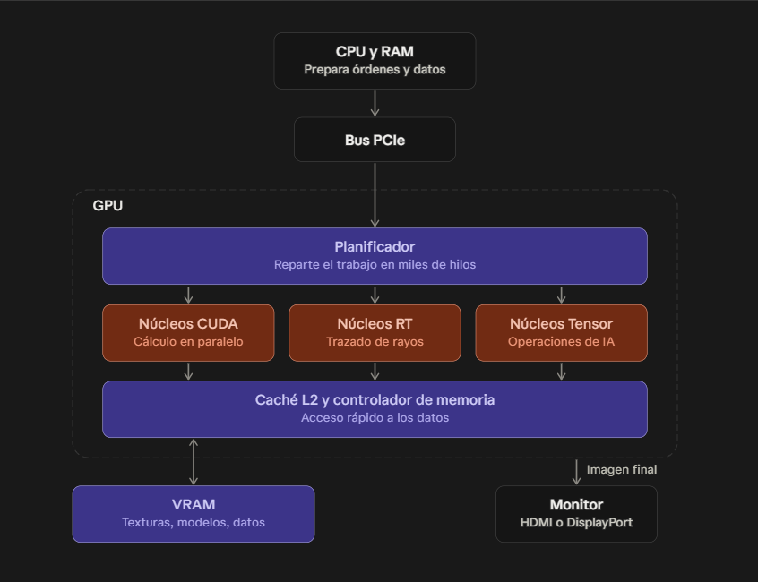

# Puzzle UT2 · Pieza NN: Nombre de la pieza

**Grupo:** Nombre Apellido (@usuario) · Esteban Amador Fernández (@esamdor23)

> Máximo 2 folios por las dos caras (unas 1.600–2.000 palabras) y al menos 3 imágenes en `img/`.

## 1. Qué es y qué función cumple en el sistema
- Las siglas GPU, significan "Unidad de Procesamiento Gráfico", en español, y es un circuito electrónico, que sirve para acelerar el procesamiento informático de gráficos e imágenes.  Al principio fue concebido como un procesador especializado en gráficos 3D, comenzó siendo un hardware de función fija, destinada a acelerar operaciones en paralelo durante el renderizado 3D en tiempo real. Durante los años posteriores, adquirieron más capacidad de programación, y en 2003 algunas etapas de canalización gráfica llamada pipeline se volvieron totalmente programables, gracias a esto se permitía la ejecución de código personalizado en paralelo para cada componente de una escena 3d o imagen. 

Su función principal es generar las imágenes que vemos, recibe de la CPU las instrucciones programa, y calcula el color de cada píxel de la pantalla, decenas o cientos de veces por segundo, y luego envía la imagen al monitor por HDMI o DisplayPort.

Otra función es acelerar cálculo en paralelo, como sus núcleos sirven para cualquier operacion matemática masiva, se usa tambien para entrenar modelos de IA, codificar y decodificar video y realizar simulaciones cientificas, mineria de datos etc.

## 2. Cómo funciona por dentro

Una GPU es un procesador pensado y especializado pensado para ejecutar la misma operación sobre muchísimos datos a la vez. La CPU envía trabajo como  geométrica, texturas, programas llamados shaders o kernels por el bus PCIe y lo reparte entre sus unidades de cálculo. Los núcleos de sombreado son las unidades que se ejecutan esos programas: los shaders son simplemente programas que corren en  estos núcleos. Cada fabricante nombra esas unidades de forma distinta, pero la estructura es parecida.
<!-- Guardad vuestras imágenes en img/ y cambiad el nombre del archivo en la línea de arriba. --> 

## 3. Características, unidades y cómo se miden

| Característica | Unidad | Valores típicos hoy | Qué significa |
|---|---|---|---|
|Frecuencia de reloj|MHz o Ghz| entre 1,5 y 3 Ghz|Indica la cantidad de ciclos de reloj que realiza la GPU por segundo|
|Memoria Gráfica VRAM| Gb|Entre 8 y 16 Gb. Las de gama alta pueden ser de 32GB| 
|Rendiento de cálculo|GFLops o TFLOPS|Aproximadamente 10-50 TFLOPS dependiendo de gama y arquitectura |Cantidad de operaciones de coma flotante que puede realizar por segundo|
|Ancho de banda GB/s| Entre 300 y 800GB/s en muchas GPU actuales. Las de gama alta pueden superor los 1000gb/s| Cantidad de datos que se pueden transferir por segundo|
|Consumo eléctrico| W vatios| Entre 100 y 350 W en muchas tarjetas de cosnumo. Las de gama alta pueden superar los 500 W| Potencia electrica que consume la GPU|
|Temperatura| ºC grados celsius| Entre los 60-85ºC| Temperatura que suelen alcanzar durante su funcionamiento|
|Rendimiento en videojuegos| Fps fotogramas por segundo|Entre 60 y 144 Fps como referencia, depende de juego resolución y calidad gráfica|Número de fotogramas que se generan o muestran por segundo|  
## 4. Tipos, evolución y estándares actuales

## 5. Un modelo real: ficha técnica interpretada

**Modelo** Nvidia GeForce RTX 5090 (https://www.nvidia.com/es-es/geforce/graphics-cards/50-series/rtx-5090/)

| Dato de la ficha | Qué significa | ¿Es bueno? ¿Para qué uso? |
|---|---|---|
|Arquitectura Blackwell| Es la tecnologia y diseño interno sobre el que esta construida la GPU|La usamos para el rendimiento grafico la eficiencia y el procesamiento de ia|
|---|---|---|
|21760 nucleos CUDA|Son unidades de procesamiento que realizan calculos en paralelo| Se utilizan para el renderizado, videojuegos calculos cientificos e ia|
|---|---|---|
Frecuencia base 2,01GHZ| Velocidad de funcionamiento de los nucleos de la GPU| Es una frecuencia alta y sirve para procesar rapidamente|
|Frecuencia Boost 2,41GHZ|Velocidad que pueda alcanzar automaticamente la GPU cuando las condiciones la permiten| Aumenta mucho el rendimiento|
|---|---|---|
|32GB DDR7|Cantidad y tipo de memoria dedicada de la tarjeta grafica| Permite trabajar con texturas en alta resolucion, videojuegos eigentes, videos y modelos IA grandes|
|---|---|---|
|Interfaz de memoria 512 bits|Anchura del bus por el que se transfieren datos| Permite transferir grandes cantidades de informacion simultaneamente|
|---|---|---|
|Ancho de banda 1.792GB/s|Cantidad de datos que puede transferir por segundo| Facilita trabajar con grandes volumenes de datos y graficos de alta calidad|
|---|---|---|
|Nucleos Tensor de 5ªgeneración|Núcleos especializados en operaciones matematicas utilizadas por la IA| Se utilizan para el aprendizaje automatico y tecnologias como DLSS|
|---|---|---|
Nucleos Ray Tracing de 4ª generacion|Unidades especializadas en calcular iluminacion sombras y reflejos| Se utiliza para conseguir graficos mas realistas en videojuegos y aplicaciones 3D|
|---|---|---|
|3352 AI tops| Capacidad de procesamiento de operaciones de inteligencia artificial por segundi| Peermite acelerar tareas de IA y generacion de imagenes|
|---|---|---|
|PCI express 5.0| Interfaz de conexion entre la placa base y la GPU| Ofrece un gran ancho de banda para la comunicacion con el resto del ordenador|
|---|---|---|
|Potencia Gráfica 575 W| Consumo electrico aproximado| Es una potencia alta, necesita una buena fuente de alimentacion y una refrigración acorde|
|---|---|---|
|Resolución máxima 8k|Resolucion de imagen que puede transmitir a una pantalla compatible| Permite trabajar y jugar a gran resolución|
|3 displayPort y 1 HDMI| Conexiones disponibles para monitores |Permite conectar hasta 4 pantallas|
|---|---|---|
|Direct x12 Ultimate| Conjunto de tecnologias y herramientas que permiten ejecutar graficos avanzados en videojuegos| Muy buenom permite aprovechar gráficos modernos|
|---|---|---|

[Modelo Nvidia Geforce RTX 5090](img/Rtx5090.jpg) -->

## 6. Averías típicas y errores al elegirla o instalarla

## 7. Fuentes

1.
2.
3.

## Uso de IA

Qué preguntamos a Jarvis u otra IA y cómo comprobamos sus respuestas.
